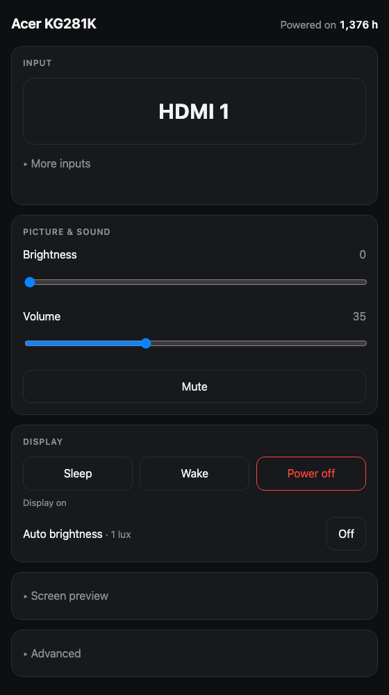
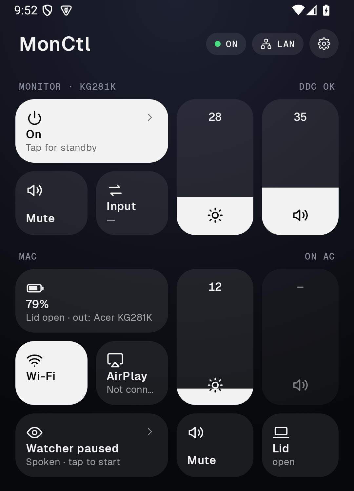

# MonCtl

Control an external monitor from a Mac over DDC/CI: brightness, volume, input,
colour, power, and the rest of the on-screen menu. It is written for one setup,
an Acer KG281K on USB-C → DisplayPort, driven from an Intel MacBookPro16,1.
Other monitors may work for the common controls. Nothing here has been tested on
them, and Apple Silicon is not supported (the I2C path is Intel-only).

macOS has no brightness slider for external displays. DDC/CI is the channel
that carries those commands, over the DisplayPort AUX lines in the cable.

## Why this exists

I broke my MacBook's screen, so the Acer is my only display. It has several
inputs (the Mac on DisplayPort, a PS4 on HDMI) and its on-screen menu is slow, so
switching input or brightness by hand was a chore. `monctl` started as a way to
do that from the Mac.

The Android app came from playing the PS4 from bed. To check the Mac, or switch
the monitor back, I had to get up and walk to it. Now the phone does it. The
tunnel is the main route because my home LAN address changes with DHCP. The
Bluetooth route is for trips: when I take the laptop and an Android tablet
somewhere with no Wi-Fi, or a phone hotspot doesn't auto-connect, I can still
control the Mac from within about 10 m. It is not a remote route. From anywhere
else, the tunnel is the only way in.

The AirPlay-display watcher exists for the same broken screen. It keeps a
usable display up when the laptop panel can't, and speaks when something drops.

## What you get

| Front end | Where | Use it for |
| --- | --- | --- |
| `monctl` | CLI, zsh | Scripting, exact values, relative steps (`monctl b +10`) |
| MonCtl.app | Menu bar | Sliders, input buttons, window-to-screen mover |
| Web panel | `monctl web`, port 8770 | Brightness, volume, power, plus the whole OSD menu (38 controls) |
| Android app + widget | `android/` | Remote control over LAN, Cloudflare tunnel or Bluetooth |
| Screen preview | Web panel and app | Live view of the Mac's screen, with full-resolution download |
| `monctl watch` | CLI | Reports changes made with the monitor's own buttons |
| `monctl auto` | CLI | Auto-brightness from the Mac's ambient light sensor |

## How it fits together

```text
monctl (zsh CLI) ─┐
MonCtl.app (Swift)├──> ddcprobe (C, IOKit I2C) ──> DDC/CI over DP AUX ──> monitor
webui/server.py  ─┤        flock /tmp/monctl-ddc.lock
watch.py         ─┤
autobright.py    ─┘   (alsread: ambient light sensor)

phone ──LAN :8770─────────────┐
      ──Cloudflare tunnel─────┼──> webui/server.py
      ──BLE──> monctl-ble ────┘          └──> MonCtlShot.app (screen capture)
```

`ddcprobe` is the only code that touches the hardware. DDC has no transaction
isolation: two processes reading at once receive each other's replies as
plausible but wrong values. `ddcprobe` therefore holds an exclusive lock for its
whole run, which lets every front end run at the same time. The CLI's basic
verbs (`status`, `b`, `c`, `v`, `mute`, `rgb`, `input`) are the exception: they
still call Homebrew `ddcctl`, which ignores the lock.

## Requirements

- An Intel Mac with the monitor on a DisplayPort or USB-C DisplayPort-alt cable.
  HDMI and some docks do not pass DDC through.
- macOS 15 or later for the screen preview (ScreenCaptureKit). Other parts were
  written on macOS 15.
- Xcode command line tools (`swiftc`, `clang`) and Python 3 (standard library
  only).
- [ddcctl](https://github.com/kfix/ddcctl) from Homebrew, for the CLI's basic
  verbs only.
- For the Android app: Android SDK platform 35 and JDK 17. For the tunnel:
  `cloudflared`.

## Quick start

```bash
git clone https://github.com/xiziphus/monctl && cd monctl
./build.sh          # apps into ~/Applications, helpers into ~/bin, monctl symlinked
monctl              # status of every control
monctl b 60         # brightness
monctl web          # control panel at http://127.0.0.1:8770
```

`build.sh` builds `MonCtl.app`, `MonCtlBLE.app`, `MonCtlShot.app`, and the three C
helpers (`ddcprobe`, `alsread`, `dimmer`). Add `~/bin` to your `PATH`. To keep
the menu bar app running, add it under System Settings → General → Login Items.

The server, watcher and app call `~/bin/ddcprobe`, not the copy in the repo.
After editing a `.c` file, reinstall it:

```bash
clang -O2 -o ddcprobe ddcprobe.c -framework IOKit -framework CoreFoundation
install -m 755 ddcprobe ~/bin/ddcprobe
```

There are no automated tests. To verify a change, run it against the monitor
(`monctl`, `ddcprobe get 10`) and check that the panel changed.

## The CLI

```bash
monctl                    # every control, with meters
monctl b | b 50 | b +10   # brightness: read, set, step
monctl v 30               # volume          monctl c 60   # contrast
monctl mute | unmute | toggle
monctl source hdmi1       # dp | hdmi1 | hdmi2
monctl temp 6500          # colour temperature preset
monctl on | off | hardoff # power (see below)
monctl watch --notify     # report OSD button presses
monctl web | autostart on # control panel, or start it at login
monctl pair               # pairing link for the Android app
monctl --help             # the rest
```

Power has three different meanings, and they are not interchangeable:

| Command | VCP | Effect | Undo |
| --- | --- | --- | --- |
| Display sleep | none (`pmset displaysleepnow`) | The Mac stops sending a picture | Wake with `caffeinate -u`, or touch the Mac |
| `off` / `standby` | `D6=4` | Monitor goes dark and drops the DDC bus | Physical button only |
| `hardoff` | `D6=5` | LED off | Physical button only |

Any DDC write fails while the display sleeps, because the panel drops its bus.
User-initiated writes wake the display once and retry. Background polls never
do, otherwise a poller would keep a dark monitor lit.

## Web panel



`monctl web` serves `webui/index.html`, a single file with no build step. It
has brightness, volume, mute, input, power, auto-brightness, the screen preview
and a collapsed Advanced section generated from `/api/catalog`. To expose another
VCP control, add it to `CATALOG` in `webui/server.py`; the server validates every
write against that table and rejects unknown codes.

The server binds to 127.0.0.1. With `--lan` it listens on the network and
requires a token (see Security).

## Screen preview and screenshots

The web panel (Screen preview section) and the Android app show the Mac's
screen at about one frame per second, only while open. Each has a button for a
full-resolution PNG: "Download full-resolution screenshot" on the web, SAVE on
Android (to Pictures/MonCtl).

- Works over the tunnel and the LAN, behind the same token as everything else.
- Never wakes a sleeping display; it answers 409 instead.
- Shows only what the Mac draws. An HDMI source on the Acer is not visible.
- Every request is logged to `~/.local/share/monctl/screen.log` as JSON lines
  (time, client IP, route, display, status, bytes, user agent). Downloads and
  failures are logged one by one. The preview stream is logged once when it
  starts, or resumes after 60 s of silence. The file is mode 0600 and rotates
  at 5 MB.
- Capture is done by `MonCtlShot.app` (`shot/monctl-shot.swift`), not by
  Python. Grant Screen Recording to that app only: System Settings → Privacy &
  Security → Screen & System Audio Recording → add `~/Applications/MonCtlShot.app`.
  Rebuilding re-signs it ad hoc, so macOS may ask again.

## Android app

`android/` is a Kotlin and Compose app with a home-screen widget in five sizes.
It controls the monitor (power, brightness, volume, mute, input) and the Mac
(volume, built-in brightness, Wi-Fi, AirPlay, the AirPlay-display watcher), and
shows the screen preview.



Setup on the Mac, once:

1. `monctl autostart on` runs the server at login with `--lan` and creates the
   token at `~/.config/monctl/token`.
2. Create a Cloudflare tunnel to `http://127.0.0.1:8770` and run it under its own
   LaunchAgent. The config lives in `~/.cloudflared/monctl.yml` and is not in
   this repo.
3. `monctl pair` prints a `monctl://pair?...` link, and a QR code if `qrencode`
   is installed. It holds the LAN URL, tunnel URL and token. Open it on the
   phone.

Build and install:

```bash
cd android && ./gradlew assembleDebug
adb install -r app/build/outputs/apk/debug/app-debug.apk
```

`android/publish.sh` builds the app and publishes it to the in-app update
channel (`~/.local/share/monctl/android`). The app checks on every open, verifies
the SHA-256, and installs through `PackageInstaller`. Builds are signed with
`~/.android/debug.keystore`. Keep that file: an APK signed with another key cannot
update the installed app.

On the phone, the app tries the LAN address first, after a 700 ms unauthenticated
`/api/hello` check so it does not send the token in cleartext to a stranger's
device on the same private IP. It then falls back to the tunnel, and last to
Bluetooth. Reads fall back freely. A write falls back only if the failure proves
nothing was delivered.

**Bluetooth route.** Short range (about 10 m), for when there is no network.
Its main use is telling the Mac to join a hotspot, after which the tunnel and
the preview work again. `monctl ble on` installs `MonCtlBLE.app` as a LaunchAgent.
It advertises a BLE service and forwards an allow-list of routes to the server on
loopback. Messages are AES-GCM sealed with a key derived from the token; a
per-connection nonce and a rising counter stop replays. It excludes the screen
preview and the APK.

**Not in this repo.** The Mac controls call scripts in `~/bin` that belong to the
author's setup: `wifi_on.sh`, `wifi_join.sh`, `airplay_devices.sh`,
`airplay_pick.sh`, `airplay_off.sh`, `airplay_cue.sh`, `airplay_toggle.sh`,
`airplay_watch.sh`, and `wifihelper`. Without them the Mac tiles and the watcher
do nothing. The monitor controls and screen preview do not need them.

## Security

- The token (`~/.config/monctl/token`, created on first start) is required for
  every request except `/api/hello`, and for every request that did not come
  directly from loopback. It can be sent as `?k=` (a cookie then carries it),
  as the `X-Monctl-Token` header, or as the cookie.
- `cloudflared` connects from 127.0.0.1, so a tunnelled request looks local.
  Requests carrying `Cf-Connecting-IP` or `Cf-Ray` are never treated as local.
- Ten bad tokens from one client lock it out for 10 minutes.
- The Mac and Wi-Fi routes run fixed scripts with validated arguments. Nothing
  taken from a request is ever run as a command.
- The repository is public. The token, tunnel config and the phone's URLs stay
  on your machines.
- LAN traffic is plain HTTP. On an untrusted network, use the tunnel (HTTPS) or
  Bluetooth.

## Hardware notes

This panel's DDC behaviour has quirks that cost time to find. The full table of
61 working VCP codes is in [docs/REFERENCE.md](docs/REFERENCE.md). The ones that
matter when changing code:

- Acer's capabilities string is wrong both ways. `0x8D` (mute) works but is not
  listed; `E0` and `E7` are listed but do not answer. Trust `ddcprobe scan`.
- Reading input source `0x60` always returns 15 (DisplayPort) whatever is showing.
  Writing it works from any input. The server reports only the input monctl last
  set.
- `0xE1`–`0xE9` and `0xF0` are unlabelled Acer vendor codes. Do not write them
  without a reason.
- If DDC stops answering after sleep and wake, unplug and replug the cable.
- Already ruled out: HDR, refresh above 60 Hz, and overclocking. The reasons are
  in the reference.

## Repository layout

| Path | Contents |
| --- | --- |
| `monctl` | zsh CLI |
| `ddcprobe.c`, `alsread.c`, `dimmer.c` | C helpers: raw VCP, ambient light sensor, gamma-ramp dimming |
| `MonCtl.swift` | Menu bar app |
| `webui/` | `server.py` (stdlib HTTP server and API) and `index.html` (the panel) |
| `watch.py`, `autobright.py` | OSD-change watcher, auto-brightness |
| `shot/` | `MonCtlShot.app` source, the screen capture helper |
| `ble/` | Bluetooth route helper and LaunchAgent plist |
| `android/` | Android app, widget and update publisher |
| `app/` | Old React panel. Not served; kept for reference |
| `docs/REFERENCE.md` | Detailed reference for every part |
| `com.dell.monctl.web.plist` | LaunchAgent template for the server |

## Contributing

Issues and pull requests are welcome, with one caveat: this was built against one
monitor and one Mac, so changes need to be checked on real hardware. Keep new
hardware access inside `ddcprobe`, keep new routes behind the token gate, and
keep secrets and personal URLs out of tracked files.

## License

MIT. See [LICENSE](LICENSE).
